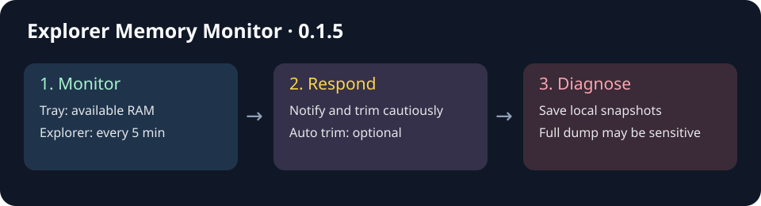

# Explorer Memory Monitor 0.5.0

**Windows memory monitoring and Explorer diagnostics** · [繁體中文](README.md)

Shows available RAM in the notification area, records Explorer memory usage and captures diagnostic information when it becomes unusually high. Manual and optional automatic working-set trimming are included. The application interface is currently in Traditional Chinese.



This diagram illustrates the workflow; it is not a screenshot.

## Features

| Feature | Default behavior |
| --- | --- |
| Tray icon | Updates about every 15 seconds; the number and % sign show the percentage of physical memory available, rounded down. Hover for the percentage and capacity. Orange below 2 GB, red below 1 GB. |
| Manual trim | Right-click or open settings and select **立即整理符合條件的閒置程式** to trim at most one process meeting the idle and once-per-process conditions below. |
| Force trim | Select **強制整理所有可存取的程式** from the tray menu or settings and confirm to attempt one pass over accessible processes belonging to the current user and session, including active apps, browsers and Explorer. Critical system components and inaccessible processes are skipped; no apps are terminated. Apps may briefly slow down. Automatic trim limits remain unchanged. |
| Automatic idle trim | On by default. A visible-window process in the current user session must have a working set of at least 1 GB, have stayed out of the foreground for at least five minutes and averaged less than 1% of one CPU core. Below 2 GB available system memory, the threshold is 100 MB and only one attempt is made per low-memory episode; it rearms after 2.5 GB remains available for five minutes. Browsers, Explorer and selected Windows components are excluded. Attempts at most once per process, at least 30 minutes apart. Toggle in the tray menu. |
| Start at sign-in | On by default for the current account. Toggle **登入 Windows 時啟動** in the tray menu. This does not control the diagnostic task. |
| Explorer diagnostics | Samples every five minutes. At 2 GB of Explorer private memory, saves process, module and system information and attempts a full memory dump, once per Explorer process. |
| Explorer automatic restart | After two checks at or above 4 GB of private memory, a successful dump and other safeguards, warns 15 seconds before restarting Explorer. Requires exactly one Explorer process in the current session and runs at most once per Windows boot. Toggle in the tray menu. |
| Low-memory alert | Warns below 1 GB of available physical RAM, at most once every 30 minutes while it remains low. |

Windows already manages memory. Trimming can temporarily increase the available figure but may cause data to be reloaded and performance to drop temporarily. It does not fix a memory leak or guarantee against crashes. Foreground and CPU measurements cannot prove a process has no background work; trimming does not terminate it. Windows notification settings can affect alerts.

## Install

Requires 64-bit Windows 10/11, .NET Framework 4.x, an interactive desktop session and administrator access on the account that will use the app. This version uses `C:\ProgramData`. Development testing was performed on Windows 11; other versions have not been fully validated. The release package includes compiled C# applications; building from source requires a C# compiler.

1. Download and extract `ExplorerMemoryMonitor-0.5.0.zip` from [Releases](../../releases).
2. Sign in to the intended administrator account, run `MemorySetup.exe`, approve the elevation prompt and choose install or update. Keep all three EXEs together. The binaries are not digitally signed.
3. Find the numeric icon in the notification area, including the hidden icons under `^`. Click it to open settings or right-click for quick controls.

Installation places the C# programs in `%LOCALAPPDATA%\ExplorerMemoryMonitor`, stores diagnostics in `C:\ProgramData\ExplorerMemoryMonitor`, configures sign-in startup for the current account and registers the `ExplorerMemoryMonitor` scheduled task. It runs every five minutes while the account is signed in and once immediately after installation. Updating preserves existing sign-in startup and automatic-trim preferences.

## Diagnostics and privacy

Data is stored in `C:\ProgramData\ExplorerMemoryMonitor`, including `samples-csharp.csv` and `capture-*` folders. A full dump can be large and may contain file contents, sign-in state or other sensitive data. **Do not publish dumps**; review their contents and recipient before sharing. Nothing is uploaded automatically, and old records are not automatically deleted. The folder is restricted to SYSTEM, administrators and the necessary access for the installing account; other administrators on the computer can still access it.

The dump is skipped if the disk has less than 5 GB plus 2.5 times Explorer's private memory available. See `dump-status.txt` in the capture folder. A failed dump is not retried for the same process. Five-minute sampling can miss short spikes.

## Uninstall

Run the extracted `MemorySetup.exe` and choose uninstall. It closes the current account's tray app and removes startup registration, tasks and C# executables, but **preserves diagnostic data and user settings**. Review and delete retained data yourself if it is no longer needed.

## Source and building

`src/MemoryTray.cs` provides the tray and settings, `src/MemoryMonitor.cs` the scheduled diagnostics, and `src/MemorySetup.cs` the installer. The `*Tests.cs` files are tests. Legacy PowerShell, VBScript and batch files are not part of this repository.

See [architecture and diagnostic data](docs/architecture.md) for implementation and test details (Traditional Chinese).

From the project folder, use PowerShell and the .NET Framework C# compiler:

```powershell
$c = "$env:WINDIR\Microsoft.NET\Framework64\v4.0.30319\csc.exe"
& $c /nologo /codepage:65001 /target:winexe /platform:x64 /reference:System.Windows.Forms.dll /reference:System.Drawing.dll /out:MemoryTray.exe src\MemoryTray.cs
& $c /nologo /codepage:65001 /target:winexe /platform:x64 /reference:System.Windows.Forms.dll /reference:System.Drawing.dll /out:MemoryMonitor.exe src\MemoryMonitor.cs
& $c /nologo /codepage:65001 /target:winexe /platform:x64 /reference:System.Windows.Forms.dll /reference:System.Drawing.dll /out:MemorySetup.exe src\MemorySetup.cs
```

Keep the three EXEs together and run `MemorySetup.exe`. The source ZIP does not include compiled EXEs; use the Release package for installation.

## Troubleshooting

- Missing icon: check hidden icons, Windows notification settings and the signed-in account.
- Missing capture: inspect the `ExplorerMemoryMonitor` task's last result and `monitor-csharp-errors.log` or `dump-status.txt` in the data folder.
- To disable automatic trimming, clear **自動整理占用偏高的閒置程式**.
- Version 0.5.0 is not a backup, recovery, medical, real-time or high-availability monitoring system.

## License

MIT. See [LICENSE](LICENSE).
