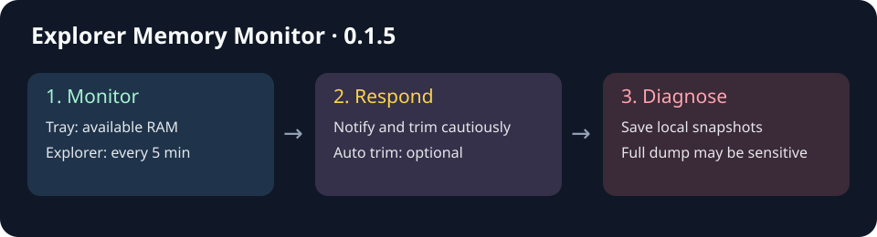

# Explorer Memory Monitor 0.4.0

**Windows 記憶體監控與檔案總管診斷工具** · [English](README.en.md)

在系統匣顯示可用記憶體，記錄檔案總管的記憶體使用量，並在異常時保存診斷資料。你可以手動整理記憶體，也可以開啟或關閉自動整理。工具介面目前為繁體中文。



上圖為功能示意，並非 Windows 實際畫面。

## 功能

| 功能 | 預設行為 |
| --- | --- |
| 系統匣圖示 | 約每 15 秒更新；數字和「%」顯示剩餘實體記憶體百分比，向下取整；滑鼠移上去可看百分比及容量。低於 2 GB 橘色、低於 1 GB 紅色。 |
| 手動整理 | 右鍵或開啟設定視窗，選「立即整理符合條件的閒置程式」，最多整理一個符合下列條件的程式，不會跳過閒置或單次限制。 |
| 閒置時自動整理 | 預設啟用；同一使用者、同一登入工作階段的視窗程式，工作集至少 1 GB、連續至少 5 分鐘未處於前景，且這段時間平均 CPU 用量低於單一核心的 1% 時，才可能整理。可用實體記憶體低於 2 GB 時，門檻降為 100 MB；同一次記憶體不足期間只整理一次，回升至 2.5 GB 並維持 5 分鐘後才重新待命。排除瀏覽器、檔案總管和部分系統程序；每個程序最多嘗試一次，自動整理至少間隔 30 分鐘。右鍵可停用。 |
| 開機啟動 | 預設在目前帳戶登入 Windows 時啟動系統匣程式；右鍵可停用。關閉這個選項不會停用診斷排程。 |
| 檔案總管診斷 | 每 5 分鐘取樣；私人記憶體達 2 GB 時通知並保存程序、模組和系統資料，嘗試產生完整記憶體傾印。每個檔案總管程序只捕捉一次。 |
| 檔案總管自動重啟 | 連續兩次檢查私人記憶體達 4 GB、已有成功傾印，而且符合安全條件時，通知 15 秒後重新啟動。目前登入工作階段須只有一個檔案總管程序，每次 Windows 開機最多自動重啟一次。右鍵可停用。 |
| 低記憶體通知 | 可用實體記憶體低於 1 GB 時提醒，持續不足時最多每 30 分鐘提醒一次。 |

Windows 會自行管理記憶體。工作集整理可能暫時增加可用量，但程式可能再載入資料，並造成短暫效能下降。它不會修復記憶體洩漏，也無法保證避免當機。閒置判斷依據前景視窗和 CPU 用量，無法保證程式沒有其他背景工作；整理不會終止程式。通知是否顯示也受 Windows 通知設定影響。

## 安裝

需求：64 位元 Windows 10／11、.NET Framework 4.x、登入 Windows 桌面，以及目前使用的帳戶具系統管理員權限；此版本使用 `C:\ProgramData` 路徑。開發測試環境是 Windows 11，尚未在其他 Windows 版本完整驗證。安裝包包含已編譯的 C# 程式；原始碼需要使用 C# 編譯器自行編譯。

1. 從 [Releases](../../releases) 下載 `ExplorerMemoryMonitor-0.4.0.zip` 並完整解壓縮。
2. 以使用工具的系統管理員帳戶登入，執行 `MemorySetup.exe`，允許權限提示後選「安裝或更新」。三個 EXE 必須放在同一個資料夾。此安裝包未經數位簽章。
3. 在工作列右下角找數字圖示；若沒有出現，點「^」查看隱藏的圖示。點一下圖示可開啟設定視窗；右鍵可快速切換設定或手動整理。

安裝會將 C# 程式放在 `%LOCALAPPDATA%\ExplorerMemoryMonitor`，將診斷資料放在 `C:\ProgramData\ExplorerMemoryMonitor`，並建立目前帳戶的登入啟動項目及 `ExplorerMemoryMonitor` 工作排程。排程每 5 分鐘執行一次，僅在安裝帳戶登入時運作；安裝完成後會立即執行一次。更新會保留原有登入啟動與自動整理設定。

## 診斷資料與隱私

診斷資料保存在 `C:\ProgramData\ExplorerMemoryMonitor`，包括 `samples-csharp.csv` 與 `capture-*` 資料夾。完整傾印可能很大，並可能包含檔案內容、登入狀態或其他敏感資訊；**不要公開上傳傾印**，分享前應先檢查接收對象及內容。程式不會自動上傳資料或刪除舊紀錄。資料夾以系統、系統管理員與安裝帳戶的必要權限設定；同一台電腦的系統管理員仍可讀取。

在可用磁碟空間不足（至少需要 5 GB 加上私人記憶體的 2.5 倍）時，程式會跳過完整傾印並記錄原因。傾印失敗時，同一程序不會自動重試；查看該捕捉資料夾的 `dump-status.txt`。程式每 5 分鐘檢查一次，可能錯過短時間的記憶體飆升。

## 解除安裝

執行解壓後的 `MemorySetup.exe`，選「解除安裝」。解除安裝會關閉目前帳戶執行中的系統匣程式，移除啟動項目、排程和 C# 程式檔案，**保留診斷資料與使用者設定**。如不再需要傾印，請自行檢查後刪除資料夾。

## 原始碼與自行編譯

`src/MemoryTray.cs` 是系統匣與設定視窗；`src/MemoryMonitor.cs` 是排程與傾印功能；`src/MemorySetup.cs` 是安裝器。`*Tests.cs` 為測試程式。儲存庫不包含舊版 PowerShell、VBScript 或批次檔。

更多程式分工、資料位置與測試方式見[程式與診斷資料](docs/architecture.md)。

在專案資料夾開啟 PowerShell，使用 Windows 內建的 .NET Framework C# 編譯器：

```powershell
$c = "$env:WINDIR\Microsoft.NET\Framework64\v4.0.30319\csc.exe"
& $c /nologo /codepage:65001 /target:winexe /platform:x64 /reference:System.Windows.Forms.dll /reference:System.Drawing.dll /out:MemoryTray.exe src\MemoryTray.cs
& $c /nologo /codepage:65001 /target:winexe /platform:x64 /reference:System.Windows.Forms.dll /reference:System.Drawing.dll /out:MemoryMonitor.exe src\MemoryMonitor.cs
& $c /nologo /codepage:65001 /target:winexe /platform:x64 /reference:System.Windows.Forms.dll /reference:System.Drawing.dll /out:MemorySetup.exe src\MemorySetup.cs
```

將三個 EXE 放在同一資料夾，再執行 `MemorySetup.exe`。原始碼 ZIP 不含已編譯的 EXE；一般使用者請下載 Release 安裝包。

## 排查

- 找不到圖示：查看「^」隱藏圖示、Windows 通知設定，並確認已登入安裝帳戶。
- 沒有診斷：在工作排程器檢查 `ExplorerMemoryMonitor` 的上次執行結果；查看資料夾內 `monitor-csharp-errors.log` 或 `dump-status.txt`。
- 不想自動整理：取消「自動整理占用偏高的閒置程式」。
- 此工具是 0.4.0 版，並非醫療、即時或高可用性監控系統；不要將它當作備份或故障復原方案。

## 授權

MIT，見 [LICENSE](LICENSE)。
